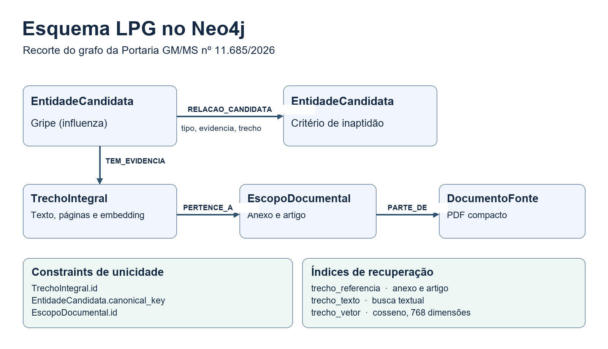

# Relatório técnico final — Recuperação de evidências para orientação à doação de sangue

## Resumo

Este trabalho implementa um assistente documental para comparar a recuperação híbrida de texto com a recuperação apoiada por grafo. O corpus deriva da Portaria GM/MS nº 11.685/2026. A aplicação usa Neo4j para armazenar trechos, embeddings e relações com evidências, e Gemma para redigir respostas em português. O protótipo permite inspecionar os trechos ranqueados e os caminhos recuperados. A avaliação disponível é funcional e exploratória.

## Metodologia

O PDF original tem 71 páginas. A versão compacta tem 50 páginas e lineariza tabelas em texto. O pipeline segmentou o corpus em 443 trechos e registrou a paginação compacta e original, bem como anexo, artigo e seção quando identificáveis. Para as tabelas, as células do original foram usadas para conferir o vínculo entre valores da mesma linha. O código exige correspondência com o texto compacto para registrar as relações documentais que extrai. A extração pelo Gemma usa saída estruturada, cache por entrada e verificação de evidência literal. A validade da citação e do formato constitui uma verificação distinta da revisão do sentido da relação.

## Modelagem e recuperação

O grafo de propriedades rotuladas contém nós TrechoIntegral, EntidadeCandidata, EscopoDocumental e DocumentoFonte. Os relacionamentos PERTENCE_A e PARTE_DE preservam a estrutura documental. TEM_EVIDENCIA associa conceitos às passagens. RELACAO_CANDIDATA guarda o tipo semântico, a evidência textual e o identificador do trecho.

As restrições de unicidade abrangem o ID dos trechos, a chave canônica das entidades e o ID dos escopos. O índice trecho_referencia apoia buscas por anexo e artigo. O índice trecho_texto dá suporte à recuperação textual, enquanto trecho_vetor compara embeddings de 768 dimensões por similaridade de cosseno. Os vetores são gerados pelo Nomic, e as respostas pelo Gemma.

A interface do RAG combina as posições das listas textual e vetorial por Reciprocal Rank Fusion. Cada lista contribui com 1/(60 + posição), com posições iniciadas em 1. A aba apresenta os três trechos mais bem classificados e seus scores. A aba GraphRAG parte dos trechos recuperados, consulta relações de até dois saltos e apresenta entidades, caminhos em texto e a resposta final. O Cypher executado é parametrizado e definido no aplicativo.

*Figura 1. Recorte do esquema LPG, das restrições de unicidade e dos índices de recuperação.*

## Resultados e limitações

A verificação do Neo4j confirmou 443 trechos com 443 embeddings e o índice vetorial online. A navegação documental foi verificada para todos os IDs do corpus. Na última contagem confirmada, havia 230 relações semânticas candidatas, com cobertura parcial dos temas. Testes funcionais incluíram perguntas sobre tatuagem e diabetes e verificações da recuperação de passagens sobre vacinação, medicamentos, procedimentos odontológicos e viagens.

Os testes identificaram perdas de contexto em tabelas continuadas e diferenças de recuperação entre perguntas completas e termos isolados. O pipeline passou a preservar títulos de tabelas continuadas. A busca também passou a tratar variantes de alguns termos, como gripado e gripe. Em testes com o modelo local, observaram-se timeouts e truncamentos. A aplicação passou a manter as fontes disponíveis quando a geração falha.

A cobertura do corpus se limita ao conteúdo textual da versão compacta. Informações exclusivas das imagens ficaram fora dessa versão, e os quadros de antissoros com cinco colunas ainda demandam estruturação. A recuperação de trechos pertinentes e os testes exploratórios não quantificam a precisão das respostas nem a redução de alucinações. A comparação acadêmica requer perguntas avaliadas contra a fonte, critérios de correção e registro das versões e configurações usadas. A aplicação oferece orientação documental, e a decisão de aptidão cabe à triagem do hemocentro.
